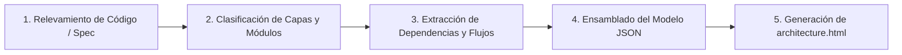

# archify

Convierte repositorios de código, planes técnicos o especificaciones de software en **documentos de arquitectura interactivos y visuales en HTML autónomo**, sin requerir servidores locales, bundlers ni dependencias externas de ejecución.

---

## 1. Capacidades Principales

- **Documento HTML Autónomo (Zero-Dependency Standalone):** Genera un único archivo `.html` ejecutable localmente con doble clic (`file:///`), conteniendo estilos, scripts, datos JSON embebidos y diagramas interactivos.
- **Vistas Arquitectónicas Múltiples:**
  - *Vista Estructural C4 / Bloques:* Mapeo de contenedores y componentes en orientación horizontal (`LR`).
  - *Vista de Flujo de Datos (Data Flow):* Trazabilidad de peticiones, eventos y pipelines de procesamiento.
  - *Matriz de Dependencias (Dependency Matrix):* Análisis de acoplamiento entre módulos y subsistemas.
  - *Diagramas de Secuencia:* Flujos temporales interactivos para casos de uso críticos.
- **Interactividad Incorporada:**
  - Búsqueda en tiempo real por nombre, responsabilidad o etiqueta tecnológica.
  - Filtros por capas arquitectónicas (Frontend, Gateway, Core Domain, Storage, External Services).
  - Panel Inspector lateral: visualiza detalles, dependencias y enlaces directos a código fuente al hacer clic en cualquier nodo.
  - Soporte de temas Claro / Oscuro (`dark` / `light`) persistente con `localStorage`.

---

## 2. Proceso de Generación

### Paso 1: Relevamiento y Fuentes de Entrada
- Si se ejecuta sobre un repositorio local, identificar módulos, paquetes, workspaces y puntos de entrada.
- Si se dispone de `codebase-memory` MCP o `graphify`, consultar el grafo para acelerar la extracción de relaciones y evitar escaneos ciegos.
- Si se basa en un plan técnico o especificación escrita (ej. `PLAN.md` o `SPEC.md`), extraer los componentes declarados.

### Paso 2: Clasificación de Capas
Asignar cada componente a una de las capas estándar:
1. **`clients`**: Interfaces de usuario (SPA, Mobile, CLI, Webhooks entrantes).
2. **`gateway`**: Reverse proxies, API Gateways, enrutadores HTTP/gRPC, controladores de autenticación.
3. **`services`**: Lógica de negocio pura, servicios de dominio, casos de uso, agregados.
4. **`storage`**: Bases de datos relacionales, documentos, cachés, colas y buckets de objetos.
5. **`external`**: APIs de terceros, pasarelas de pago, servicios de correo/SMS.

### Paso 3: Mapeo de Dependencias y Flujos
- Registrar para cada componente: `id`, `name`, `layer`, `summary`, `path`, `dependencies: [...]`, y `tags: [...]`.
- Formular los flujos de interacción para las vistas de Data Flow y Secuencia.

### Paso 4: Ensamblado y Exportación
- Embeber el JSON en `<script id="arch-data" type="application/json">` dentro de la plantilla HTML interactiva.
- Generar los diagramas Mermaid correspondientes (en orientación `flowchart LR`) con clases CSS y estilos coherentes con el tema.
- Guardar el artefacto en `architecture.html` (o `<nombre-proyecto>-architecture.html`) en la raíz del proyecto.
- Generar un resumen ejecutivo en Markdown para rápida lectura en chat o terminal.

---

## 3. Directivas de Diseño y Accesibilidad

1. **Orientación Horizontal (`LR`):**
   Todos los diagramas generados deben priorizar orientación de izquierda a derecha (`flowchart LR` o `graph LR`), garantizando legibilidad en monitores anchos sin scroll vertical excesivo.
2. **Respeto a Preferencias:**
   - Detectar `prefers-color-scheme` automáticamente.
   - Desactivar transiciones bruscas si `prefers-reduced-motion: reduce` está activo.
3. **Contraste y Legibilidad:**
   - Mantener contraste mínimo 4.5:1 para texto normal y 3:1 para texto grande o bordes activos (WCAG 2.2 AA).

---

## 4. Referencias y Plantillas

- [references/html-architecture-spec.md](references/html-architecture-spec.md): Especificación detallada de la arquitectura del archivo HTML, esquema JSON y código base interactivo.
