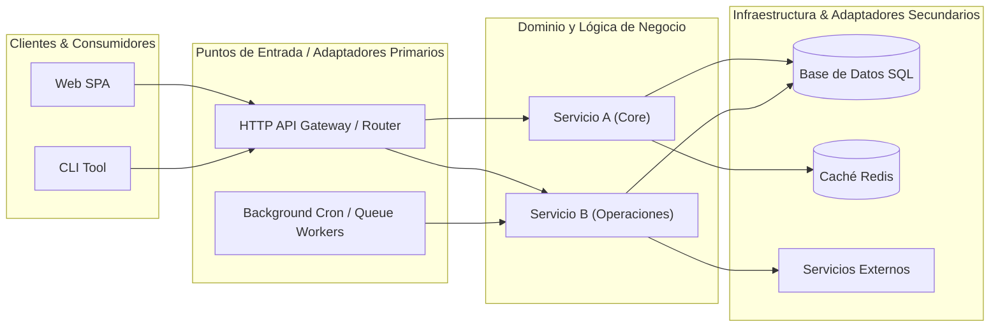
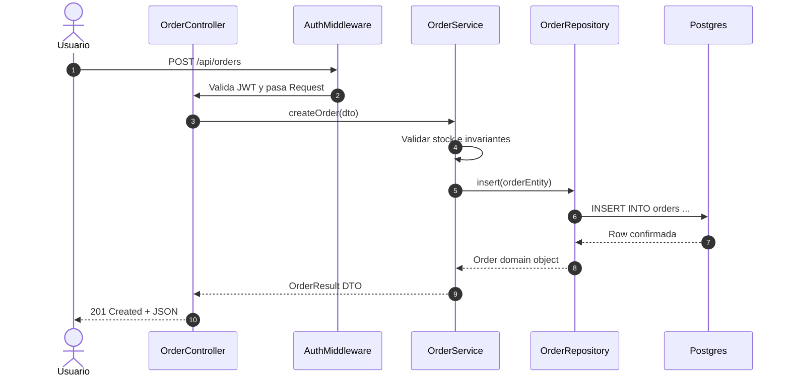

# Plantillas y Heurísticas de Comprensión Arquitectónica y Onboarding

Este documento contiene las plantillas maestras y heurísticas de análisis para la skill `understandAnything`, estructuradas para extraer modelos mentales precisos de cualquier repositorio de software.

---

## 1. Heurísticas de Exploración de Codebases

### 1.1 Jerarquía de Fuentes de Verdad
1. **Puntos de Entrada Reales:** Archivos de inicio (`main`, `index`, `server`, `cli`, manifests de rutas, definiciones de endpoints). El código que corre tiene prioridad sobre la documentación desactualizada.
2. **Definiciones de Tipos y Esquemas:** Modelos de datos (`types.ts`, `models.py`, esquemas SQL/Prisma, DTOs, protobufs). Muestran los límites conceptuales del dominio y el vocabulario canónico del sistema.
3. **Contratos y Pruebas Unitarias/Integración:** Los tests revelan el comportamiento esperado, los casos borde y las suposiciones operativas de los autores originales.
4. **Archivos de Configuración e IaC:** `package.json`, `Cargo.toml`, `pyproject.toml`, Dockerfiles, `docker-compose.yml`, GitHub Actions. Definen dependencias de terceros, servicios auxiliares (Redis, Postgres) y variables de entorno críticas.

### 1.2 Regla de Separación: Hechos vs. Inferencias
- **Hecho (Fact):** Relación, llamada a función o contrato directamente visible en código fuente comprobable con cita `[archivo:línea](file:///ruta/al/archivo#LXX)`.
- **Inferencia (Inference):** Deducción sobre la intención del diseño, posibles razones históricas o convenciones implícitas. Debe marcarse explícitamente con prefijo `[Inferencia]`.

---

## 2. Plantilla: Mapa Arquitectónico de Dominio (`map`)

```markdown
# Mapa Arquitectónico del Sistema: <Nombre del Proyecto>

## 1. Resumen de Alto Nivel
- **Propósito del Sistema:** <1-2 párrafos concisos sobre qué problema resuelve y qué valor aporta>
- **Patrón Arquitectónico:** <Ej. Monolito Modular, Arquitectura Hexagonal / Puertos y Adaptadores, Microservicios, Clean Architecture, Serverless Event-Driven>
- **Stack Tecnológico Principal:**
  - Lenguaje y Runtime: <Ej. TypeScript / Node 20+, Rust 1.80, Python 3.12>
  - Framework Backend / Frontend: <Ej. NestJS / FastAPI / Next.js>
  - Almacenamiento / Persistencia: <Ej. PostgreSQL con Prisma, Redis para caché>
  - Mensajería / Asincronía: <Ej. RabbitMQ, BullMQ, Kafka, n/a>

## 2. Diagrama Estructural del Sistema (C4 Container / Component Level)


## 3. Delimitación de Dominios / Módulos
| Módulo / Capa | Ruta en Repositorio | Responsabilidad Principal | Dependencias Clave | Puntos de Entrada |
|---|---|---|---|---|
| `<Modulo1>` | [`src/modulo1/`](file:///path/to/modulo1) | `<Qué hace>` | `<Módulos que consume>` | `<Controladores / Handlers>` |
| `<Modulo2>` | [`src/modulo2/`](file:///path/to/modulo2) | `<Qué hace>` | `<Módulos que consume>` | `<Event listeners / workers>` |

## 4. Puntos de Entrada Identificados (Entrypoints)
- **API HTTP / RPC:**
  - `POST /api/v1/resource` -> [`src/api/routes.ts:35`](file:///src/api/routes.ts#L35)
  - `GET /api/v1/status` -> [`src/api/health.ts:12`](file:///src/api/health.ts#L12)
- **Procesamiento Asíncrono / Colas:**
  - Worker `ProcessPaymentQueue` -> [`src/workers/payment.worker.ts:18`](file:///src/workers/payment.worker.ts#L18)
- **CLI / Scripts:**
  - CLI Root `app` -> [`src/cli/index.ts:10`](file:///src/cli/index.ts#L10)
```

---

## 3. Plantilla: Trazabilidad de Flujo Extremo a Extremo (`explain`)

```markdown
# Trazabilidad de Flujo: <Nombre del Caso de Uso o Endpoint>

## 1. Disparador (Trigger) y Contrato de Entrada
- **Actor / Disparador:** <Ej. Usuario autenticado envía formulario POST /api/orders>
- **Payload / Entrada:**
  ```json
  { "itemId": "123", "quantity": 2 }
  ```
- **Punto de Entrada en Código:** [`src/controllers/order.controller.ts:45`](file:///src/controllers/order.controller.ts#L45)

## 2. Secuencia de Ejecución Paso a Paso


## 3. Cadena de Llamadas Detallada (Call Chain Trace)
1. **Recepción y Validación Inicial:**
   - Ubicación: [`src/controllers/order.controller.ts#L45-L60`](file:///src/controllers/order.controller.ts#L45-L60)
   - Valida el payload con esquema Zod/Joi `OrderInputSchema`. Si falla, arroja `ValidationError` (HTTP 400).
2. **Aplicación de Reglas de Negocio:**
   - Ubicación: [`src/services/order.service.ts#L80-L115`](file:///src/services/order.service.ts#L80-L115)
   - Comprueba stock disponible en memoria/DB.
   - Aplica descuento de cliente frecuente si `user.tier === 'VIP'`.
3. **Persistencia y Transaccionalidad:**
   - Ubicación: [`src/repositories/order.repo.ts#L30-L55`](file:///src/repositories/order.repo.ts#L30-L55)
   - Inicia transacción en BD: actualiza balance de stock e inserta registro en tabla `orders`.
4. **Efectos Secundarios y Eventos:**
   - Ubicación: [`src/events/order.events.ts#L22`](file:///src/events/order.events.ts#L22)
   - Emite evento `OrderCreatedEvent` a la cola de mensajería para notificación por correo.

## 4. Invariantes y Manejo de Errores
- **Invariante 1:** Un pedido no puede crearse con cantidad <= 0.
- **Rollback:** Si la transacción en BD falla o se interrumpe la conexión, se aborta sin descontar inventario.
```

---

## 4. Plantilla: Guía de Onboarding para Desarrolladores (`onboard`)

```markdown
# Guía de Onboarding Técnico: <Nombre del Repositorio>

## 1. El Modelo Mental en 5 Minutos
- ¿Qué problema resuelve este sistema?
- ¿Cómo fluyen los datos a través del sistema?
- ¿Cuáles son las 3 dependencias fundamentales sin las cuales el sistema no funciona?

## 2. Invariantes Críticos No Negociables
> [!IMPORTANT]
> 1. **Invariante de Estado:** <Ej. El campo X nunca debe mutarse directamente; siempre usar la función Y>.
> 2. **Invariante de Concurrencia:** <Ej. Toda operación sobre saldos debe usar bloqueo optimista o SELECT FOR UPDATE>.
> 3. **Invariante de Tipos:** <Ej. No usar `any` en capas de dominio; todo DTO debe validarse al borde de entrada>.

## 3. Ruta de Lectura Recomendada (Reading Order)
Lea los siguientes archivos en este orden estricto para comprender el sistema sin perderse en detalles de implementación:

1. **Configuración y Tipos Base:**
   - [`src/types/domain.ts`](file:///src/types/domain.ts) — Glosario y tipos estructurales de negocio.
   - [`src/config/env.ts`](file:///src/config/env.ts) — Variables de entorno requeridas y flags activas.
2. **Ciclo de Vida de Arranque:**
   - [`src/index.ts`](file:///src/index.ts) o [`src/server.ts`](file:///src/server.ts) — Inicialización del contenedor de dependencias, conexiones a BD y listeners.
3. **Módulo Representativo (Happy Path):**
   - [`src/modules/core/`](file:///src/modules/core/) — Implementación canónica recomendada para replicar al crear nuevos módulos.
4. **Pruebas de Integración:**
   - [`tests/integration/`](file:///tests/integration/) — Especificación viva de los escenarios completos.

## 4. Guía de Tareas Comunes ("¿Dónde tocar para...?")
| Si necesitas... | Edita estos archivos | Ten precaución con... |
|---|---|---|
| Agregar un nuevo endpoint HTTP | `routes/`, `controllers/`, `dto/` | Autenticación y validación de schemas |
| Añadir un campo al modelo de datos | `models/`, migraciones SQL, `types/` | Índices de consulta y compatibilidad retroactiva |
| Consumir un nuevo servicio externo | `infrastructure/clients/`, `config/` | Timeouts, reintentos y circuit breakers |
| Modificar el flujo de autenticación | `middleware/auth.ts`, `tokens/` | Sesiones activas y rotación de claves |

## 5. Entorno Local y Verificación Rápida
- **Instalación:** `npm install` o `pnpm install`
- **Levantar dependencias:** `docker-compose up -d`
- **Ejecutar en desarrollo:** `npm run dev`
- **Correr tests:** `rtk test npm test` o `npm test`
```
